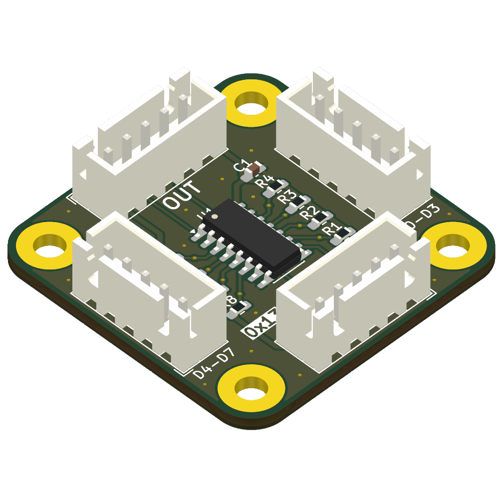
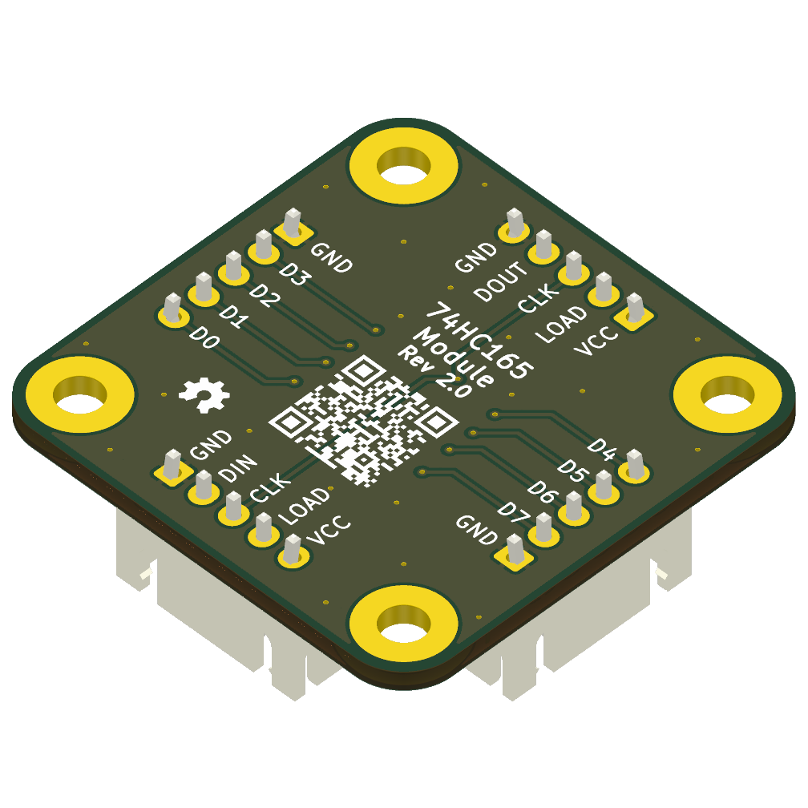
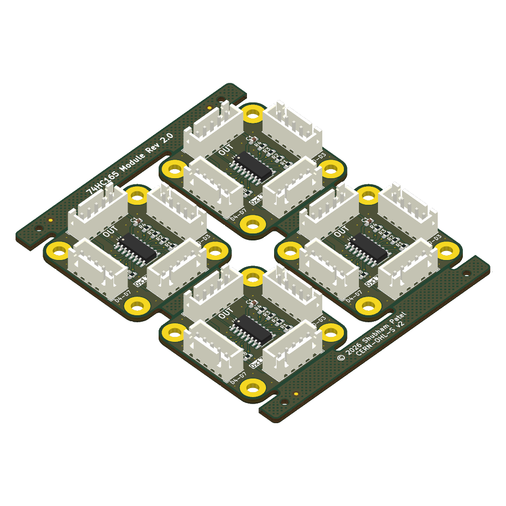
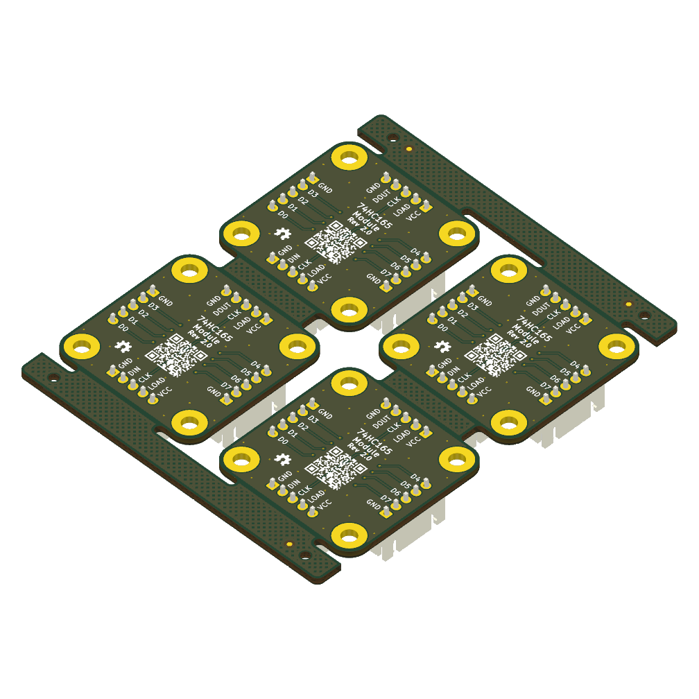

# 74HC165 Daisy-Chainable Shift Register Module - Rev 2.0

[](LICENSE)
[](https://www.kicad.org/)

A simple, compact,  daisy-chainable breakout module based on the **74HC165 8-bit parallel-in/serial-out shift register**. It allows you to add digital inputs to any microcontroller in multiples of 8, using only 3 GPIO pins plus power and ground.

> [!NOTE]
> **Revision History:** Rev 2.0 is the first published release. The unpublished Rev 1.0 had a mirrored input header—while it worked standalone, daisy-chaining with a standard straight-through JST cable would short `VCC` to `GND`. Both headers now share the exact same pin order for safe, plug-and-play chaining. Rev 2.0 also changes the `DIN` termination from a pull-down to a pull-up to align with the default unpressed state of the input pins.

<!-- markdownlint-disable MD033 -->
<div align="center">
  
  &emsp;&emsp;&emsp;&emsp;&emsp;
  
</div>
<!-- markdownlint-enable MD033 -->

## Features & Specs

* **Inputs:** 8 digital inputs via two 5-pin JST-XH headers (4 inputs + shared GND per header).
* **Daisy-Chain:** Connect modules in series to expand inputs in multiples of 8, sharing the same `CLK`, `LOAD`, `VCC`, and `GND` lines.
* **Passives:** Onboard 10 kΩ pull-ups on all inputs, a 100 kΩ pull-up on `DIN` (to ensure that if the MCU reads more bits than are physically connected, the floating/ghost values default to 1, matching the unpressed state of the buttons), and a 100 nF decoupling capacitor.
* **Power:** 2.0V – 6.0V. **Use a VCC compatible with your microcontroller's logic levels** (e.g., 3.3 V for RP2040/ESP32, 5 V for standard Arduino).
* **Dimensions:** 35 × 35 mm (Four M3 mounting holes at 27 × 27 mm).
* **Compatibility:** Standard 74HC165 logic — compatible with DIY firmware such as **FreeJoy** and standard shift-register libraries for **Arduino** (`shiftIn`), **CircuitPython** (`adafruit_74hc165`), and other platforms.

## Pinout

### Chaining Headers (J1 & J2)

Both 5-pin headers share the same pin layout:

1. **VCC:** Power (Match your MCU logic level)
2. **LOAD:** Parallel Load / Latch
3. **CLK:** Clock
4. **DATA:** Serial Data (`DIN` on J1, `DOUT` on J2)
5. **GND:** Ground

**Wiring Guide:**

* **Single Module:** Connect **J2** to your microcontroller. Leave **J1** empty.
* **Daisy-Chaining:** Connect MCU ➔ **J2** (Module 1). Plug Module 1's **J1** ➔ **J2** (Module 2). Repeat for additional modules.

### Button Headers (J3 & J4)

* **D0–D7:** Digital inputs for your buttons/switches.
* **GND:** Shared ground pins.

> [!NOTE]
> Inputs have hardware pull-ups (active-low). Wire your switches directly between `Dx` and `GND`. The MCU will read `1` (HIGH) when open, and `0` (LOW) when pressed.

## Manufacturing & Downloads

<!-- markdownlint-disable MD033 -->
<p align="center">
  
  &emsp;&emsp;
  
</p>
<!-- markdownlint-enable MD033 -->

Ready-to-order fabrication files are available in the [Releases](https://github.com/shubham0x13/74hc165-module/releases) tab. Each release includes:

* **Gerber `.zip` files** (Single board & 4-board panel)
* **Assembly BOMs** (Interactive HTML BOM for easy hand-soldering, plus standard CSV)
* **Schematic PDF** & **STEP 3D Model**

> [!IMPORTANT]
> The 4-board panel (75 × 91 mm) is generated via KiKit and outputs V-score/cut lines on the `User.Comments` layer by default. When ordering the panel, ensure this layer is included in your Gerbers and explicitly request **V-scoring** in your order notes.

## Build Automation

To easily regenerate artifacts after modifying the PCB, a [justfile](justfile) is provided. It uses the KiCad CLI, KiKit, and InteractiveHtmlBom to generate the panel layout, Gerbers, STEP model, BOMs, schematic PDF, and 3D renders.

**Requirements:**

* [KiCad 10.0+](https://www.kicad.org/) (`kicad-cli` must be available in `PATH`)
* [just](https://just.systems/) command runner
* Python 3.10+ (Linux/macOS; Windows uses KiCad's bundled Python)
* [KiKit](https://github.com/yaqwsx/KiKit) (v1.8.1+)
* [InteractiveHtmlBom](https://github.com/openscopeproject/InteractiveHtmlBom) (v2.12.0+)
* **Windows:** Git for Windows (must be in your system PATH to provide `sh.exe` for commands like `rm` and `mkdir`).

**Usage:**

The build system is self-documenting. Run `just` from the repository root to see a list of all available commands and what they do.

```bash
# See all available build commands
just
```

## License

This project is open-source hardware licensed under the **CERN-OHL-S v2**. See [LICENSE](LICENSE) for details.
